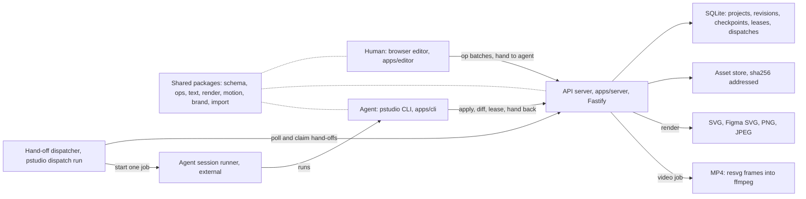

# Post Studio

A small Figma-like canvas built for a human + agent loop: an agent drafts a post, you adjust it, and the agent
reads it back as structure. Keyframes and MP4 export.

<!-- screenshot: GIF (10–15 s) of the desktop editor at 1440×900 on a demo project titled "Demo post" with neutral
placeholder text ("Weekly update", "Three things we shipped") and plain grey/blue shapes, no brand kit and no real
brand: select the headline, drag it, change its size in the Properties panel, then press "Hand to agent" and type
"make the headline shorter, keep my layout". -->

<!-- screenshot: one still (or a 3 s GIF) from the MP4 export of the same demo project after a "slide-up-in" preset
on the headline and a "pop" preset on a shape, plus the desktop timeline strip under the canvas with the keyframe
diamonds visible. -->

<!-- screenshot: the phone review view in a 384×854 mobile viewport (open any project URL with ?view=phone) on the
demo motion project: preview with the play/scrub bar, the status card ("whose turn", "N kept") and the bottom bar
(History, Approve, Hand to agent). -->

## The problem

Coding agents are good at producing a first draft of a social post, but a person still wants to nudge the layout by
hand, and an agent that regenerates the whole file on its next turn quietly throws those nudges away. Design files
(SVG, Figma) are hard for an agent to read back: they hold geometry, not "this is the headline and the human moved
it". Post Studio keeps the post as a typed JSON scene graph that both sides edit through the same op API, with
turns, pins and history, so the agent can see exactly what the human changed and build on top of it.

## Architecture



- The **server** is the only source of truth. Every change, from the editor or the CLI, is a batch of ops against a
  known base revision. The server checks turns, the agent lease and pins, rebases or rejects, validates, and stores
  one new revision with its author (`human` or `agent:<name>`).
- The **editor** (React + Zustand) and the **CLI** import the same `packages/*` code. The editor uses the packages'
  `browser` entry points, so it shapes text with the same HarfBuzz layout and draws the same SVG markup the server
  exports.
- **Rendering** is done by the server: `packages/render` turns a document (optionally at a time `t`) into SVG; PNG
  comes from the outlined SVG through resvg-js, JPEG through sharp, and MP4 by piping resvg frames into ffmpeg.
- **Hand to agent** in the editor writes a hand-off checkpoint and a dispatch row. A host-side dispatcher polls for
  it and starts exactly one agent job, which then works through the CLI like any other agent.

More detail: [docs/design.md](docs/design.md) (document model, ops, rendering, motion, API) and
[docs/agent-loop.md](docs/agent-loop.md) (turns, pins, hand-off and the dispatcher).

## Stack

- TypeScript monorepo, pnpm workspaces, Node 22, run through `tsx` (only the editor has a build step)
- Server: Fastify 5, better-sqlite3 (WAL), zod schemas, an allow-list SVG sanitizer
- Editor: React 19, Vite 7, Zustand; SVG DOM canvas, desktop editor plus a phone review view
- Text: harfbuzzjs with registered woff2 fonts (Latin + Cyrillic, language-aware `locl`)
- Rendering: resvg-js (PNG), sharp (JPEG), ffmpeg/libx264 (MP4)
- CLI: commander, `--json` on every command, exit codes per failure kind
- Tests: Vitest, fast-check (property tests), playwright-core driving headless Chrome for the editor e2e tests
- Deploy: Docker (read-only root, `cap_drop: ALL`), compose with Traefik labels, systemd user units for backup and
  the dispatcher

## Interesting engineering

- **One document model, three clients.** `packages/schema` (zod, `post-studio/2`, with a migration chain from
  `/1`) and `packages/ops` (`apply`, inverse ops, `diff`, `outline`, pins, rebase) are shared by the server, the
  CLI and the editor. Undo in the editor is just the inverse ops sent as a new revision; history is never
  rewritten. `apply` + inverse is covered by property tests (`packages/ops/test/apply.property.test.ts`).
- **Concurrent human and agent edits without a CRDT.** Three layers in `apps/server/src/store.ts` →
  `applyOps`: turns (the project is the human's or the agent's), a 15-minute agent lease that makes the editor
  read-only, and optimistic revision checks. A batch written against an old base is rebased when its footprint
  does not overlap what was written since (`packages/ops/src/rebase.ts`), otherwise it is a 409 listing the
  conflicting paths. Everything the human changed since the agent's last turn is **soft-pinned**; an agent op that
  touches a pinned property is refused (422, CLI exit 4) unless it passes an explicit override with a reason.
- **What you see is the export.** The editor canvas renders the exact markup `packages/render` produces, with every
  glyph placed at its HarfBuzz x so the browser cannot drift from the outlined PNG. Tests compare Chrome's
  rendering of the live SVG with the resvg PNG (`packages/render/test/render.test.ts`), and
  `apps/server/test/render-regression.test.ts` checks sha256 hashes of the SVG, Figma SVG, outlined SVG and PNG of
  every still fixture against `fixtures/golden/still-render-hashes.json`, with and without a time, to prove that
  adding motion changed no byte of a still render.
- **Keyframes and MP4 from the same renderer.** `packages/motion` is the only code that interpolates (eases,
  sampling, frame times `round(i × 1000 / fps)`); editor playback, contact sheets and export all call it. The
  video path (`packages/render/src/video.ts`) streams frames into ffmpeg with a bounded number rasterizing at once,
  so frames are never all in memory. The server queues encode jobs, caches finished MP4s by document, frame, scale
  and renderer version, and serves them with Range requests for phone playback.
- **A hand-off that starts an agent exactly once.** `apps/cli/src/dispatch.ts` claims a dispatch row before it
  starts a job, tags the job with a unique `--source`, and on restart adopts an orphaned claim by looking that
  source up in the runner instead of starting a second job. The worker prompt deliberately does not contain the
  human's note; the agent reads it through `pstudio handoff show`, which keeps the prompt free of user text.
- **Phone review view.** On a coarse-pointer screen the same app switches to a touch layout
  (`apps/editor/src/ui/phone/`): preview with pinch-zoom, plain-text edits that keep styled words intact,
  history, approve, play/scrub motion posts, download or share the MP4, and hand off with "pointing at" chips and
  the paused moment.

## Run it locally

Needs Node 22+, pnpm 9 (`corepack enable`), and ffmpeg on `PATH` for video. Commands below run from the repo root.

```bash
pnpm install --frozen-lockfile
export POST_STUDIO_DATA="$PWD/.data"            # scratch data dir (git-ignored)
alias pstudio="$PWD/apps/cli/bin/pstudio"       # keeps the CLI's exit codes (pnpm maps them all to 1)

pstudio admin set-password --generate .data/admin-password   # editor login: user "nikola", password in that file
pstudio token create demo-agent --save          # agent token, saved to ~/.config/post-studio/token (0600)
pstudio serve                                   # builds the editor if needed; http://127.0.0.1:3472
```

In a second terminal (same `alias`), act as the agent:

```bash
pstudio templates                                          # brand-kit templates
pstudio create --template <id> --title "Demo post" --json  # returns the project id and editor URL
pstudio outline <project>
pstudio render <project> --out /tmp/demo.png
pstudio anim preset <project> --node headline --preset slide-up-in --at 0.4 --dur 0.6 --out /tmp/ops.json
pstudio apply <project> --base 0 --ops /tmp/ops.json -m "headline slides in" --json
pstudio video <project> --scale 0.5 --out /tmp/demo.mp4
```

Open the editor URL, log in, move something and press **Hand to agent**; then follow
[docs/agent-loop.md](docs/agent-loop.md) (`handoff show` → `lease take` → `diff` → `apply` → `handoff back`).
`pnpm --filter @post-studio/editor dev` runs the editor with hot reload on port 5173 (it proxies `/v1` to 3472).

**Configuration.** Nothing needs an env file for a local run. [`.env.example`](.env.example) at the root lists
every variable the server, CLI, video export, dispatcher and tests read, with defaults. The code does not load it
by itself: export the ones you change (`set -a; . ./.env; set +a`). `deploy/.env.example` is separate: it only
holds the optional overrides that `deploy/compose.yaml` interpolates (domain, host data dir, loopback port,
trusted proxy subnet).

**Docker.** `docker compose -f deploy/compose.yaml up -d --build` builds the image (editor included, Debian
ffmpeg) and runs it read-only with the data dir bind-mounted at `/data`. The compose file expects an external
`proxy` network and a Traefik instance; for a plain local container, drop the `networks` and `labels` blocks.

## Tests

```bash
pnpm check              # typecheck (server + editor tsconfig) + eslint + vitest
pnpm test               # vitest only
VITEST_MAX_FORKS=1 pnpm test   # on small machines (vitest.config.ts reads it; default 2 workers)
```

Last full run on a clean clone: `pnpm install --frozen-lockfile`, `pnpm typecheck` and `pnpm lint` clean;
`pnpm test` → **50 of 50 files, 531 passed, 1 skipped**. The skipped step exports into a sibling content project
that is not in this repo.

- The 11 editor e2e files (`apps/editor/test/*.e2e.test.ts`) drive the real editor in headless Chrome against an
  in-process server; the loop tests use the real `pstudio` CLI as the agent. They use `$CHROME` or the newest
  Playwright headless shell under `~/.cache/ms-playwright`, and skip when neither is found.
- Video tests need ffmpeg (`POST_STUDIO_FFMPEG`, `PATH`, or `~/.local/bin/ffmpeg`) and skip without it.
- The palette parity tests run the original Python checker when `python3` is present, else a stored golden file.
- With the default 2 workers, the Chrome-heavy files can time out on a RAM-tight machine; `VITEST_MAX_FORKS=1`
  fixed that in the reference run.

## Repository layout

| Path | What it is |
|---|---|
| `apps/server` | Fastify API, SQLite store (revisions, checkpoints, leases, dispatches), auth, assets, render and video jobs, backups |
| `apps/editor` | React editor (canvas, layers, properties, history, timeline) and the phone review view |
| `apps/cli` | `pstudio`: the agent CLI, admin commands, and the hand-off dispatcher (`dispatch.ts`) |
| `packages/schema` | Document schema (zod), JSON Schema, migrations |
| `packages/ops` | Apply / invert / rebase ops, pins, readable diff and outline, multi-layer edits |
| `packages/text` | HarfBuzz text layout and the font registry |
| `packages/render` | Document → SVG (live, Figma, outlined), PNG, JPEG, MP4 |
| `packages/motion` | Eases, keyframe sampling, frame times, presets, motion validation |
| `packages/brand` | Brand kits (colours, type styles, guides, templates) and the palette checker |
| `packages/import` | SVG / post-folder importers and the SVG-paste converter |
| `brand-kits/`, `fonts/` | Kit JSON and templates; registered woff2 fonts with their licences |
| `fixtures/` | Test documents, imported post fixtures, golden hashes |
| `deploy/`, `Dockerfile`, `scripts/` | Container, compose, backup and dispatcher units, installers, evidence scripts |

## Status and limits

- A personal, self-hosted tool, used by one person with a few agents. Single editor user, bearer tokens for agents.
  Not multiplayer: one side edits at a time (turns and a lease), there are no live cursors.
- Deliberately small: no pen tool or bezier editing, no gradients, filters or blend modes in native layers (complex
  SVG art is kept as whole `svg` layers), no auto layout or components.
- Motion MVP: up to 60 s, transform/opacity/text-reveal tracks only (no colour or size animation), no audio or
  video layers, no GIF/WebM, no keyframe editing on the phone.
- The dispatcher expects an external agent session runner with a `start` / `list --json` interface (configurable
  with `POST_STUDIO_SESSIONS`) and optionally pings Telegram; without it, hand-offs still work and an agent can be
  started by hand.
- The four shipped brand kits (`lux`, `kites`, `mosaic`, `studio`) and the fixtures built on them are a neutral
  demo set: made-up names, a placeholder logo and example domains, kept so the templates, palette checks and
  golden renders have realistic material to work on. They are test and template data, not a design system.

## Licence

MIT, see [LICENSE](LICENSE). Fonts under `fonts/` keep their own licences (SIL OFL 1.1, see `fonts/LICENSES.md`).
