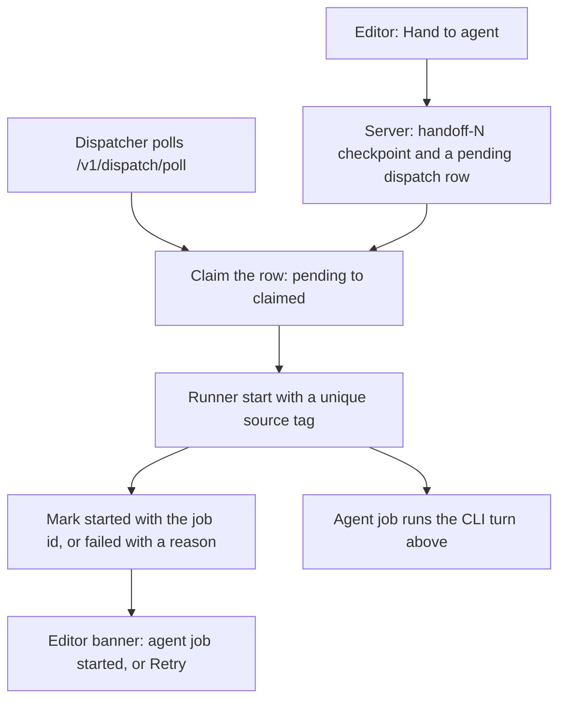

# The human ↔ agent loop

The loop Post Studio is built around:

1. An agent creates a post (from a brand-kit template, an imported post folder, or its own scene JSON).
2. The person opens it in the editor and adjusts it by hand.
3. The person presses **Hand to agent** with a note ("make the headline shorter, keep my layout"), optionally
   pointing at layers and, on a motion post, at a moment on the timeline.
4. The agent reads what changed as structure, edits on top **without undoing the person's tweaks**, renders to
   check its own work, and hands back.
5. Repeat until the person approves. The approved revision is exported.

The rules that make step 4 safe are enforced by the server, not by the agent's good behaviour.

## Turns, lease, pins

A project is always in one side's turn: `human` or `agent`.

| An agent wants to | Allowed when | Otherwise (CLI exit code) |
|---|---|---|
| `lease take` | it is the agent's turn and nobody else holds the lease | 6 not your turn, 5 leased |
| `apply`, `revert`, `restore` | it is the agent's turn, or it is the human's turn but the human has changed nothing since the agent's last checkpoint (polishing a fresh draft) | 6, or 5 while another agent holds the lease |
| `handoff back` | same as apply | 6 |
| `approve`, `handoff give`, `take-back`, write `pins` / `locked` / `strictPalette` | never, human only | 1 (HTTP 403) |

- **Lease.** While an agent holds the lease (15 minutes, renewable), the editor is read-only and shows who is
  working. Nobody else can write.
- **Soft pins.** Every property the person set, every node moved and every node added since the agent's last
  `agent-N` checkpoint is pinned automatically. An op touching one is refused (HTTP 422, exit 4) with the list of
  blocked keys. Other properties of the same node stay writable: new words in a headline the person moved are fine.
- **Explicit pins.** The person can pin a property or a whole node permanently.
- **Override.** `--override-pin node.path="reason"` exists for when the note explicitly asks for that change; the
  reason is shown to the person in History.
- **Revision check.** Every apply carries `--base`. If someone wrote since then and the footprints do not overlap,
  the batch is rebased onto the head; if they overlap, it is a 409 (exit 3) with the conflicting paths.

Checkpoints name the moments both sides compare against: `created`, `handoff-N`, `agent-N`, `approved`.

## One agent turn with the CLI

```bash
pstudio handoff show <p> --json        # turn must be "agent"; read the note, focus (pointed layers) and at (moment)
pstudio lease take <p>                 # editor goes read-only
pstudio diff <p>                       # what the person changed since the agent's last turn, per layer
pstudio pins <p>                       # what may not be touched
pstudio outline <p>                    # the document as a short tree; `get` for full JSON and the base rev
pstudio apply <p> --base <rev> --ops ops.json -m "what and why" --dry-run --json   # warnings, text overflow
pstudio apply <p> --base <rev> --ops ops.json -m "what and why"
pstudio render <p> --frame <id> --out /tmp/p.png           # look at every frame
pstudio render <p> --frame <id> --contact --out /tmp/c.png # motion: 12 moments in one image
pstudio handoff back <p> --summary "one line: what changed, what was kept"
```

A real example from a scratch server: the person moved the headline and changed its size, then handed over with
"shorter headline, keep my layout". The agent's attempt to move the headline back was refused with
`set headline.x touches pinned headline.x`; changing the headline's words went through as a new revision, and
`handoff back` created `agent-1` and gave the turn back. The editor then lists exactly the agent's changes and
outlines those layers.

**Motion posts** follow the same rules on a time axis. `pstudio timeline <p>` prints a text timeline;
`diff` speaks in times (`dy in1 0.40 s → 0.70 s`). If the person retimed a keyframe, its time is soft-pinned: the
agent may change its value or ease, but not move or delete it. `pstudio anim preset` only writes an ops file, which
is then applied with `--base` like any other change, so pins and conflicts still apply.

The full loop runs as tests with the real editor in headless Chrome standing in for the person and the real CLI as
the agent: `apps/editor/test/loop.e2e.test.ts` (two rounds, revert, approve, export) and
`apps/editor/test/motion-loop.e2e.test.ts` ("make the intro punchier" at a paused moment, the person's retimed
keyframe survives, the refused write exits 4).

## The editor side

- **Hand to agent** with a note creates `handoff-N`. Selected layers (desktop) or layers picked in Point mode
  (phone) go along as removable "Pointing at" chips; a paused playhead on a motion post adds an "At 1.20 s" chip.
- Dashed pin marks show which of the person's changes are protected on the next agent turn.
- After the agent hands back, a "What the agent changed" card lists its changes and highlights those layers.
- **Take it back** cancels a hand-off the agent has not started. **History** offers revert of one revision or
  restore of a whole version. **Approve** creates the `approved` checkpoint that export uses by default.

## Hand-off dispatch

Without a dispatcher, the person tells an agent to take its turn. With one, pressing **Hand to agent** is enough.



How `apps/cli/src/dispatch.ts` keeps it to exactly one job per hand-off:

- **Claim before start.** The dispatcher claims a row (attempt + 1) before it launches anything; a claim is refused
  when the hand-off is no longer current (taken back, superseded, or the agent already handed back).
- **Recover, never repeat.** Each job is started with a unique source tag (`post-studio-handoff:<project>:<handoff>:<attempt>`).
  If a dispatcher died between start and "mark started", the next one finds the claim orphaned, looks the tag up in
  the runner's job list, and adopts the job, or marks the hand-off failed so the person can press **Retry**.
- **Single instance.** A pid lock refuses a second dispatcher process.
- **Least privilege.** The dispatcher's token can call only `/v1/dispatch/*` and `/v1/whoami`; every other token
  and the editor get 403 there. The dispatcher runs on the host, outside the container, so the container never
  sees the runner or any messaging credentials.
- **No user text in the prompt.** The worker prompt names the project, the hand-off and the editor link, and tells
  the agent to read the note itself with `pstudio handoff show`, treating it as a request about this project only.
- **Back-pressure and switches.** At most `POST_STUDIO_DISPATCH_MAX` (default 2) hand-off jobs at once; the rest
  wait with a banner. A kill-switch file or `POST_STUDIO_DISPATCH=off` keeps polling but starts nothing, so the
  editor can say "Auto-start is switched off". Without polls for two minutes the editor says auto-start is not
  running.
- **Notification.** One optional "started" message per job to a Telegram chat (`POST_STUDIO_DISPATCH_CHAT`), with
  the bot token read from an env file per message and never logged.

The runner itself is an external program (in the author's setup, the session runner of a separate agent-orchestration
project). Anything that accepts `start --kind --model --bot --chat --project --title --prompt-file --source --json`
and `list --json` can stand in; `POST_STUDIO_SESSIONS` sets the command. `apps/cli/test/dispatch.test.ts` drives the
dispatcher against a fake runner and covers claims, recovery, caps, the kill switch and failures.

Install as a systemd user unit with `scripts/install-dispatch.sh` (creates the dispatcher token once and enables
`deploy/post-studio-dispatch.service`; adjust the paths in that unit to where you cloned the repo first). One poll by hand: `pstudio dispatch once --json`.
